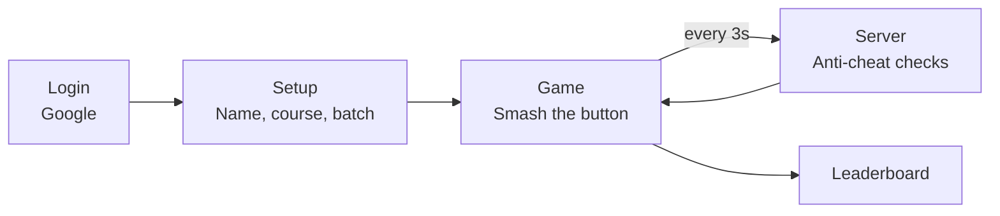

# 🔴 The Mystery Button

**A wacky 90s-style clicker game with a very strict anti-cheat system.**

> **Live link:** https://mystery-button-tau.vercel.app/
> The event cutoff (**Aug 14, 2026, 4:00 PM IST**) has passed, so the button no longer scores.

---

## What is this?

Students sign in with Google, smash a big red button as fast as they can, and compete on a live leaderboard. The **top 3 players at the cutoff won Mystery Prizes and a reward certificate** (see [below](#-reward-certificate)).

| | |
|---|---|
| **Why we built it** | A college event needed a simple, competitive game. A clicker is easy to cheat, so the real work was making it fair. |
| **Who it's for** | Students (24 courses, 3 batches) who play, and organizers who need a winner list they can trust. |

---

## Features

| Feature | What it does |
|---|---|
| 🔴 Big Red Button | Animated button with `+1` particles and sound effects |
| 🏆 Live Leaderboard | Filter by course and batch, medals for the top 3 |
| 🔔 Rank Toasts | Pop-ups when you reach the top 50, 25 and 10 |
| 🎁 Milestone Popups | Reward images at 1K, 2.5K, 5K and 10K clicks |
| ⏰ Event Countdown | Locks the game for everyone at the same moment |
| 🧩 Gamified CAPTCHA | A "tap the right shape" challenge that catches bots |
| 🛡️ Anti-Cheat | 8 server-side layers (explained below) |
| ☕ Bribe the Dev | A joke popup that leads to a "buy us chaya" QR code |

---

## How it works



---

## 🏅 Reward Certificate

Each of the **top 3 players** at the cutoff receives a reward certificate with their own name on it, recognising their Top 3 position in The Mystery Button challenge.


| Position | Reward |
|:---:|---|
| 🥇 1st | Mystery Prize + certificate |
| 🥈 2nd | Mystery Prize + certificate |
| 🥉 3rd | Mystery Prize + certificate |

---

## 🛡️ How the anti-cheat works

**The idea:** only real, human clicks count. Everything is checked on the **server**, because anything in the browser can be faked.

| # | Layer | What it does |
|:-:|---|---|
| 1 | **Event cutoff** | Rejects all scores after `2026-08-14T10:30:00Z` (4:00 PM IST), using the server clock |
| 2 | **Authentication** | Every request needs a valid Clerk login, so one Google account has one score |
| 3 | **Cooldown** | Requests less than 2 seconds apart get `429 Too Fast` |
| 4 | **Timing clamp** | Accepts at most `min(claimed, seconds × 15, 45)` clicks per batch |
| 5 | **Shadowban routing** | A banned player's clicks go to a fake `shadow_score` |
| 6 | **Rolling rate cap** | Over 1200 clicks in 60s is a strike; 3 strikes in a row is a ban |
| 7 | **Variance check** | Perfectly even click gaps (under 5 ms spread) at a high rate means an autoclicker |
| 8 | **CAPTCHA** | About 10% of syncs show a 5-second "tap the star" challenge; 2 fails is a ban |

### What happens to a caught cheater?

Their clicks stop counting, they see a **CHEATING DETECTED** popup on the game page, and they never appear on the leaderboard. Everyone sees the same genuine-only board.

### Cheaters vs. the system

| The cheater says... | What actually happens |
|---|---|
| "I'll open 10 tabs!" | Same Google account, same row. One score. |
| "I'll send 1000 requests a second!" | `429 Too Fast`. Everything inside the 2-second gap is dropped. |
| "My script sends `clicks: 9999`!" | The server accepts at most 45 for that batch. |
| "My autoclicker clicks every 100 ms exactly!" | Machine-perfect timing is flagged by the variance check. |
| "My bot sends perfect requests!" | A CAPTCHA appears. Bots can't see shapes. |
| "I'll change my laptop clock!" | The cutoff uses the server's clock, not yours. |

<details>
<summary><b>Code peek: timing clamp and variance check</b></summary>

```js
// Timing clamp: only what is humanly possible for the time that passed
const elapsed = Math.min(secondsSinceLast, 30);
const safeClicks = Math.min(reportedClicks, elapsed * 15, 45);

// Variance check: how uneven are the gaps between clicks?
const gaps = timestamps.slice(1).map((t, i) => t - timestamps[i]);
const mean = gaps.reduce((a, b) => a + b, 0) / gaps.length;
const stddev = Math.sqrt(gaps.reduce((a, g) => a + (g - mean) ** 2, 0) / gaps.length);
if (stddev < 5 && rollingRate >= 0.8 * RATE_CAP) banPlayer();
```

All of this lives in `api/_anticheat.js` and uses no external libraries.
</details>

---

## 🧰 Tech stack

| Part | Tools |
|---|---|
| **Frontend** | React 19, Vite 6, React Router 7, plain CSS |
| **Login** | Clerk (Google sign-in) |
| **Backend** | Node.js serverless functions on Vercel (`api/`), Express for local development (`server/`) |
| **Database** | Neon (serverless PostgreSQL), one `players` table |
| **Hosting** | Vercel |

**How clicks travel:** the browser counts clicks locally (max ~15 per second), sends them in one batch every 3 seconds, and the server runs the checks above before updating the score.

### API

| Method | Endpoint | Login needed | Purpose |
|---|---|:-:|---|
| `GET` / `POST` | `/api/player` | ✅ | Get or create your player |
| `POST` | `/api/score` | ✅ | Submit a click batch (runs all checks) |
| `POST` | `/api/verify-captcha` | ✅ | Check a CAPTCHA answer |
| `GET` | `/api/leaderboard` | – | Ranked list with course and batch filters |
| `GET` | `/api/rank` | ✅ | Your current rank |

### Project structure

```text
mystery-button/
├── api/        Vercel serverless functions (anti-cheat lives in _anticheat.js)
├── client/     React app (pages, components, public media)
├── server/     Express server for local development
├── docs/       README images
├── init.sql    Database schema
└── vercel.json Deployment config
```

---

## 🚀 Run it locally

```bash
git clone https://github.com/dhanush-girish/mystery-button.git
cd mystery-button
npm run install:all
```

Create a `.env` file in the **project root** (it is already git-ignored):

```env
VITE_CLERK_PUBLISHABLE_KEY=your_clerk_publishable_key
CLERK_SECRET_KEY=your_clerk_secret_key
DATABASE_URL=your_neon_connection_string
```

Run the contents of `init.sql` in your Neon SQL editor, then start everything:

```bash
npm run dev
```

The game opens on **http://localhost:5173** and talks to the local API on port 3001.
To deploy, import the repo into Vercel and add the same three variables.

---

## 👥 Team

<table>
<tr>
<td align="center" width="50%" valign="top">

**Dhanush Girish**
<br/>Game, backend, anti-cheat, database and deployment

[GitHub](https://github.com/dhanush-girish)

</td>
<td align="center" width="50%" valign="top">

**Sayandh Raj**
<br/>Overall maintenance and testing (including testing the anti-cheat and CAPTCHA), documentation and README

[GitHub](https://github.com/sayandhsr) · [LinkedIn](https://www.linkedin.com/in/sayandh-raj) · [Kaggle](https://www.kaggle.com/sayandhsr) · [Portfolio](https://sayandh-tech.vercel.app/)

</td>
</tr>
</table>

## 📚 More docs

[Event Summary](./Mystery_Button_Event_Summary.md) · [Project Documentation](./Mystery_Button_Project_Documentation.md) · [Full-Stack Study Guide](./FullStack_Study_Guide.md)

<div align="center">

**Built with ☕ and questionable amounts of clicking.**

</div>
