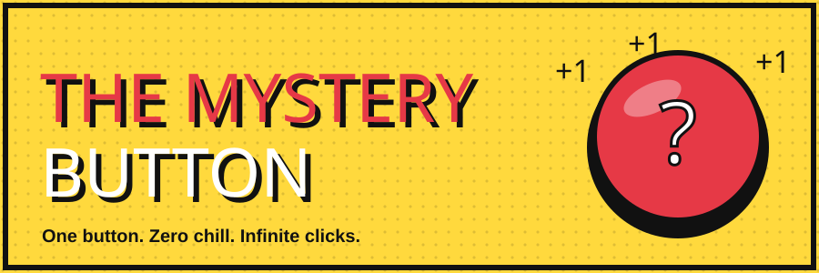
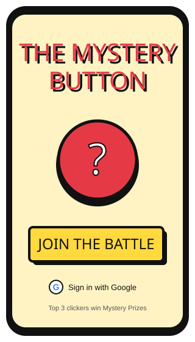
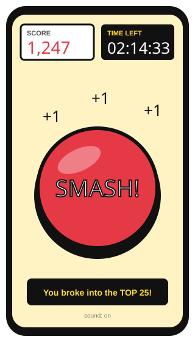
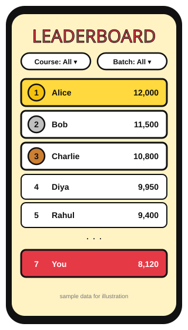
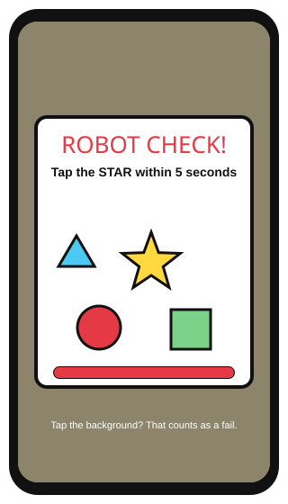
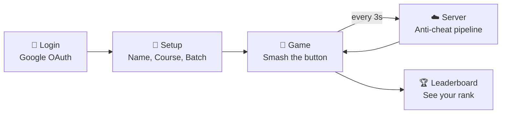
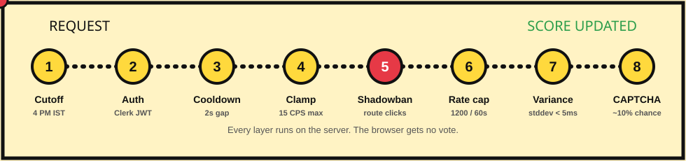
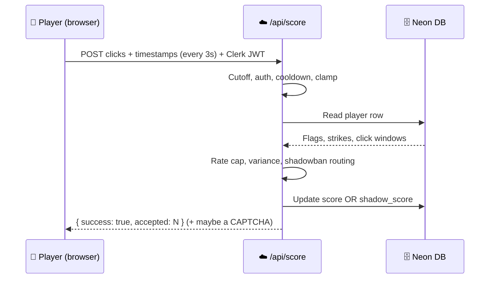

<div align="center">



<br/>

[](https://mystery-button-tau.vercel.app/)
[](#-the-anti-cheat-protocol)
[](#-spot-the-bot-interactive)


### *A wacky 90s-style clicker game with a very evil anti-cheat system.* 😈

</div>

> 🕹️ **Live link:** **https://mystery-button-tau.vercel.app/**
> The event cutoff (**Aug 14, 2026, 4:00 PM IST**) has passed, so the button no longer scores. This README tells you how it all worked.

---

## 🧭 Quick Navigation

| 🎮 Play | 🧠 Understand | 🛠️ Build | 👥 People |
|---|---|---|---|
| [What is it?](#-what-is-this) | [Anti-cheat](#-the-anti-cheat-protocol) | [Tech stack](#-tech-stack) | [Team](#-team) |
| [Screens](#-screens) | [Spot the bot](#-spot-the-bot-interactive) | [API](#-api-reference) | [Credits](#-credits) |
| [Features](#-features) | [Cheater stories](#-cheater-stories) | [Run locally](#-run-it-locally) | |

---

## 🎯 What Is This?

**In one line:** students sign in with Google, smash a big red button as fast as humanly possible, and fight for the top of a live leaderboard, while a hidden anti-cheat system quietly sends cheaters to a fake universe.

The **top 3 real clickers** at the cutoff won **Mystery Prizes** 🎁.

> *What was the prize? A mystery. That's why it's called the Mystery Button.* 🕵️

<table>
<tr>
<td width="33%" valign="top">

### 💡 Why?
A college event needed something **simple** (button, number go up), **competitive** (live leaderboard, friendships end in seconds) and **fair**.

Fair is the hard part. A clicker game is a cheater's dream.

</td>
<td width="33%" valign="top">

### 👥 For whom?
- 🎓 **Students** across 24 courses and 3 batches
- 🧑‍💼 **Organizers** who need a winner list they can trust
- 🧑‍💻 **Learners** who want a real serverless + auth + anti-cheat example

</td>
<td width="33%" valign="top">

### 🧠 The real project
The button is the easy bit.

**The real project is making sure nobody cheats the button.**

</td>
</tr>
</table>

---

## ✨ Features

| | Feature | What it does |
|:-:|---|---|
| 🔴 | **Big Red Button** | Animated, with `+1` particles and selectable sound effects |
| 🏆 | **Live Leaderboard** | Filter by course and batch, auto-refreshes, medals for the top 3 |
| 🔔 | **Rank Toasts** | Pop-ups when you break into the top 50, 25, and 10 |
| 🎁 | **Milestone Popups** | Reward images at 1K, 2.5K, 5K, and 10K clicks with Kerala-flavored captions |
| ⏰ | **Event Countdown** | Synced to a hardcoded UTC cutoff, so the game locks for everyone at once |
| ☕ | **Bribe the Dev** | A joke popup with a video that leads to a "buy us chaya" QR code |
| 🧩 | **Gamified CAPTCHA** | A shape-tapping mini-game that randomly appears to catch bots |
| 👻 | **Shadowban System** | Cheaters get their own fake leaderboard. Evil. Beautiful. |

---

## 📱 Screens

> These are illustrated mockups (animated, so open the README on GitHub to see them move) with sample data. Swap in real screenshots any time by replacing the files in `docs/images/`.

<div align="center">

| 🔐 Login | 🔴 Game | 🏆 Leaderboard | 🧩 CAPTCHA |
|:---:|:---:|:---:|:---:|
|  |  |  |  |
| *"JOIN THE BATTLE"* | *Smash it* | *Medals and filters* | *Tap the star!* |

</div>

### 🔄 Player journey



1. **Login:** click "JOIN THE BATTLE" and sign in with Google.
2. **Setup:** first-timers enter name, course, and batch.
3. **Game:** mash the button. The score updates instantly on your screen.
4. **Sync:** every **3 seconds**, clicks go to the server as one batch, not one request per click.
5. **Leaderboard:** check rankings and filter by course or batch (no login needed to view).

---

## 🛡️ The Anti-Cheat Protocol

> ### 🏆 The Golden Rule: *A cheater should never know they got caught.*

### 👻 The big idea: shadowbanning

When we catch a cheater, we **don't** kick them out, show an error, or freeze their screen. Instead:

- Their clicks silently go to a fake `shadow_score` instead of the real `score`.
- Their screen still shows the score going up. They feel like a winner.
- The leaderboard **hides them** from legitimate players.
- But **they still see themselves** on the board with their fake score.

<div align="center">

</div>

### 🚦 The request pipeline

<div align="center">

</div>

### 🧱 The 8 layers

| # | Layer | What it does | Key rule |
|:-:|---|---|---|
| ① | ⏰ **Event Cutoff** | Rejects everything after the deadline | Hardcoded `2026-08-14T10:30:00.000Z` (4:00 PM IST), checked on the *server clock* |
| ② | 🔒 **Authentication** | Every request needs a valid Clerk JWT | One Google account = one score row |
| ③ | ⏱️ **Batch Cooldown** | Blocks rapid-fire scripts | Under 2 seconds since the last sync returns `429 Too Fast` |
| ④ | 📐 **Timing Clamp** | Caps what the server will accept | `min(reported, elapsed × 15, 45)`, elapsed capped at 30s |
| ⑤ | 👻 **Shadowban Passthrough** | Banned clicks go to `shadow_score` | The API response looks identical |
| ⑥ | 📊 **Rolling Rate Cap** | Catches sustained fast clicking | Over 1200 clicks per 60s is a strike, 3 consecutive strikes means a ban |
| ⑦ | 🤖 **Variance Analysis** | Detects machine-perfect timing | Ban if stddev of click gaps is under 5ms **and** the rate is at least 80% of the cap |
| ⑧ | 🧩 **Gamified CAPTCHA** | Random "tap the right shape" challenge | About 10% chance per sync, 5s timer, 2 failures means a ban |

The same ghosting logic applies to `/api/rank`, so a banned player's position never looks suspicious.

### 🔍 Peek inside (click to expand)

<details>
<summary><b>🔨 The shadowban itself</b></summary>

<br/>

```js
if (player.is_shadowbanned) {
  // fake score, player never knows
  await sql`UPDATE players SET shadow_score = shadow_score + ${safeClicks} WHERE clerk_id = ${id}`;
} else {
  await sql`UPDATE players SET score = score + ${safeClicks} WHERE clerk_id = ${id}`;
}

// identical response either way
return res.json({ success: true, accepted: safeClicks });
```
</details>

<details>
<summary><b>📐 Timing clamp: why <code>{ clicks: 9999 }</code> doesn't work</b></summary>

<br/>

```js
const elapsed = Math.min(secondsSinceLast, 30);   // stops "sleep and claim" attacks
const safeClicks = Math.min(reportedClicks, elapsed * 15, 45);
```

3 seconds passed, the client claims 9999 clicks? The server accepts **45**. The rest vanish. 🪄
</details>

<details>
<summary><b>🤖 Variance check: how the bot detector thinks</b></summary>

<br/>

```js
const gaps = [];
for (let i = 1; i < timestamps.length; i++) gaps.push(timestamps[i] - timestamps[i - 1]);

const mean = gaps.reduce((a, b) => a + b, 0) / gaps.length;
const variance = gaps.reduce((a, b) => a + (b - mean) ** 2, 0) / gaps.length;
const stddev = Math.sqrt(variance);

if (stddev < 5 && rollingRate >= 0.8 * RATE_CAP) banPlayer();
```

| Who | Click gaps | Std. deviation | Verdict |
|---|---|---|---|
| 🧑 Human | 80, 120, 95, 110, 70 ms | ~20 ms | ✅ Natural jitter |
| 🤖 Autoclicker | 100, 100, 100, 100 ms | 0 ms | 🚨 Machine-perfect |

Both conditions must be true (uniform timing **and** high rate), so a gaming mouse with a "turbo" feature at a low rate isn't punished.
</details>

<details>
<summary><b>🧩 CAPTCHA: issue and verify</b></summary>

<br/>

```js
// Issue: ~10% of syncs
if (Math.random() < 0.10) {
  const shapes = ["circle", "star", "triangle", "square", "diamond"];
  const target = shapes[Math.floor(Math.random() * shapes.length)];
  // store target + issue time in the DB, send shapes with random x/y
}

// Verify
const tooSlow = (Date.now() - issuedAt) > 5000 + 2000;   // 5s + 2s network grace
const wrong = answer !== pendingTarget;
if (tooSlow || wrong) { failures += 1; if (failures >= 2) banPlayer(); }
```

Clicks on the overlay background (not on a shape) also count as a failure.
</details>

<details>
<summary><b>👻 Leaderboard ghosting (two SQL queries)</b></summary>

<br/>

```sql
-- normal viewer: hide banned players
SELECT name, score FROM players WHERE is_shadowbanned = FALSE ORDER BY score DESC;

-- banned viewer: show everyone, using the fake total
SELECT name, (score + shadow_score) AS score FROM players ORDER BY score DESC;
```
</details>

<details>
<summary><b>📡 What the server sends back</b></summary>

<br/>

Normal response (identical for legit players **and** shadowbanned ones, which is the whole trick):
```json
{ "success": true, "accepted": 42 }
```

Random CAPTCHA:
```json
{
  "success": true,
  "captcha_required": true,
  "captcha": {
    "target_shape": "star",
    "shapes": [
      { "type": "triangle", "x": 15, "y": 30 },
      { "type": "star", "x": 55, "y": 45 },
      { "type": "circle", "x": 35, "y": 60 }
    ],
    "timeout_ms": 5000
  }
}
```

Too fast: HTTP `429 Too Fast`. After the event: HTTP `403`.
</details>

---

## 🤖 Spot the Bot (interactive)

Each round shows the **gaps between clicks** (in milliseconds) of two players. One is a human, one is a script. **Pick your guess, then click to reveal.**

### Round 1

| Player | Gaps between clicks |
|---|---|
| **A** | `82, 121, 97, 108, 74` |
| **B** | `100, 100, 100, 100, 100` |

<details>
<summary>🔎 <b>Who's the bot?</b> (click to reveal)</summary>

<br/>

**Player B.** Every gap is exactly 100ms, so the standard deviation is **0 ms**. Player A's gaps wobble by about **17 ms**, which is what a human hand does.
</details>

### Round 2

| Player | Gaps between clicks |
|---|---|
| **C** | `60, 61, 59, 60, 60` |
| **D** | `55, 140, 90, 62, 118` |

<details>
<summary>🔎 <b>Who's the bot?</b> (click to reveal)</summary>

<br/>

**Player C.** Its standard deviation is under 1 ms, far below the 5 ms line. Player D's timing is messy, which is perfectly human.
</details>

### Round 3 (the tricky one)

| Player | Gaps between clicks |
|---|---|
| **E** | `71, 112, 88, 124, 79` |
| **F** | `74, 109, 91, 118, 83` |

<details>
<summary>🔎 <b>Who's the bot?</b> (click to reveal)</summary>

<br/>

**Trick question: you can't tell from this.** A smarter autoclicker that adds *random* delays looks human to the variance check. That's exactly why the system has **8 layers**: rate caps, the timing clamp, and the CAPTCHA are backups for when one layer is fooled.
</details>

---

## 🦹 Cheater Stories

| 🦹 The cheater says... | 🛡️ What actually happens |
|---|---|
| *"I'll open 10 tabs and click in all of them!"* | All 10 tabs share one Google account and one database row. **One score.** Tabs don't stack. |
| *"I'll script 1000 requests every 100ms!"* | **429 Too Fast.** Anything under the 2-second gap is thrown away. |
| *"My script sends `{ clicks: 9999 }`!"* | The server accepts **45**. Humanly possible clicks only. |
| *"An autoclicker with perfect 100ms timing!"* | The **variance check** sees 0ms of jitter. Machine-perfect is not human. |
| *"My bot sends flawless API requests!"* | A **CAPTCHA** appears. Bots can't see shapes, and two failures means a ban. |
| *"I'll change my laptop clock to keep clicking after 4 PM!"* | The cutoff uses the **server's clock**. Your laptop has no vote. 🗳️ |
| *"Haha, I'm #1 with 50,000 points!"* | On *your* screen, yes. Everyone else can't see you. See you at prize time. 💀 |

### 🎬 The cheater's journey

```text
Step 1  Cheater opens the game       → must sign in with Google
Step 2  Cheater fires an autoclicker → clamped, rate-checked, variance-checked
Step 3  💀 SHADOWBANNED              → but they don't know
Step 4  Cheater keeps playing        → happily watching a fake score go up
Step 5  Event ends at 4:00 PM        → real leaderboard shows real winners
Step 6  Cheater checks results       → 😭
```

> **TL;DR:** We don't block cheaters. We let them play in their own fake universe where everything looks fine. 😈

---

## 🧰 Tech Stack

### 🎨 Frontend
| Tool | Role |
|---|---|
| **React 19** | Component-based single-page app |
| **Vite 6** | Fast dev server and build tool |
| **React Router 7** | Login → Setup → Game → Leaderboard |
| **Clerk React SDK** | Google sign-in modal |
| **Vanilla CSS** | Retro / neo-brutalist look with the *Bangers* font |

Frontend tricks worth knowing:
- Client-side throttle at about **15 clicks/sec** (67ms minimum gap)
- Batched sync every **3 seconds**
- `keepalive: true` on `beforeunload` flushes unsent clicks when you close the tab
- Rank polling every **10 seconds**
- Per-click `Date.now()` timestamps sent to the server for the bot math

### ⚙️ Backend (one codebase, two modes)
| Mode | Tech | Purpose |
|---|---|---|
| 🚀 **Production** | Vercel Serverless Functions (`api/*.js`) | Each route is its own tiny function |
| 🛠️ **Development** | Express.js (`server/index.js`) | A normal local server with hot reload |

Shared modules, written once: `api/_anticheat.js` (all anti-cheat logic) · `api/_auth.js` (Clerk JWT verification) · `api/_db.js` (Neon connection)

### 🗄️ Data and services
| Tool | Role |
|---|---|
| **Neon** (serverless PostgreSQL) | Players, scores, and cheat-tracking data |
| **Clerk Backend SDK** | Verifies login tokens on the server |
| **Vercel** | Hosts the frontend and the backend |

---

## 🗃️ Database Schema

One table. That's it.

```sql
CREATE TABLE players (
  clerk_id TEXT PRIMARY KEY,
  name TEXT NOT NULL,
  course TEXT NOT NULL,
  batch TEXT NOT NULL,
  score INTEGER DEFAULT 0,
  last_click_sync TIMESTAMPTZ DEFAULT NOW(),
  last_click_count INTEGER DEFAULT 0,

  -- Anti-cheat fields
  is_shadowbanned BOOLEAN DEFAULT FALSE,
  shadow_score INTEGER DEFAULT 0,
  click_windows JSONB DEFAULT '[]',
  rate_violations INTEGER DEFAULT 0,
  pending_captcha_id TEXT DEFAULT NULL,
  pending_captcha_target TEXT DEFAULT NULL,
  captcha_issued_at TIMESTAMPTZ DEFAULT NULL,
  captcha_failures INTEGER DEFAULT 0
);
```

Indexed on `course`, `batch`, and `score DESC`.

> **Why is all the anti-cheat state in the database?** Serverless functions have no shared memory and shut down between requests, so every bit of state lives in the player's row.

---

## 🔌 API Reference

| Method | Endpoint | Auth | What it does |
|---|---|:-:|---|
| `GET` | `/api/player` | ✅ | Fetch your profile and score |
| `POST` | `/api/player` | ✅ | Create or update your player (onboarding) |
| `POST` | `/api/score` | ✅ | Submit a click batch (runs the full anti-cheat pipeline) |
| `POST` | `/api/verify-captcha` | ✅ | Verify your CAPTCHA answer |
| `GET` | `/api/leaderboard` | Optional | Ranked list with course and batch filters |
| `GET` | `/api/rank` | ✅ | Your current rank |



---

## 📁 Project Structure

```text
mystery-button/
├── api/                        # Vercel serverless functions (production)
│   ├── _anticheat.js           # ← ALL anti-cheat logic lives here
│   ├── _auth.js                # Clerk JWT verification
│   ├── _db.js                  # Neon DB connection
│   ├── score.js                # POST /api/score
│   ├── player.js               # GET/POST /api/player
│   ├── leaderboard.js          # GET /api/leaderboard
│   ├── rank.js                 # GET /api/rank
│   └── verify-captcha.js       # POST /api/verify-captcha
│
├── client/                     # React frontend
│   ├── src/
│   │   ├── pages/              # Login, Setup, Game, Leaderboard
│   │   ├── components/         # BigRedButton, CaptchaChallenge, EventTimer,
│   │   │                       # PlusOneVFX, MuteToggle, RankToast,
│   │   │                       # SearchDropdown, ProtectedRoute
│   │   ├── App.jsx             # React Router config
│   │   ├── main.jsx            # Entry point + ClerkProvider
│   │   └── index.css           # All styles
│   └── vite.config.js
│
├── server/                     # Express dev server (local only)
│   ├── index.js                # All routes (mirrors api/*.js)
│   └── db.js                   # DB connection with dotenv
│
├── docs/images/                # README illustrations
├── init.sql                    # Database schema
├── vercel.json                 # Deployment config
└── package.json                # Monorepo scripts
```

---

## 🚀 Run It Locally

> ⚠️ Check the exact script names in `package.json` and the variable names your code reads. The steps below follow the common setup for this stack.

```bash
# 1. Clone
git clone https://github.com/dhanush-girish/mystery-button.git
cd mystery-button

# 2. Install
npm install
```

**3. Create free accounts**
- 🔐 [Clerk](https://clerk.com): enable Google sign-in and copy your keys
- 🐘 [Neon](https://neon.tech): create a database and copy the connection string

**4. Add a `.env` file** (never commit it!)
```env
VITE_CLERK_PUBLISHABLE_KEY=your_clerk_publishable_key
CLERK_SECRET_KEY=your_clerk_secret_key
DATABASE_URL=your_neon_connection_string
```

**5. Create the table:** run the contents of `init.sql` in the Neon SQL editor.

**6. Start**
```bash
npm run dev
```

### ☁️ Deployment

| Component | Platform |
|---|---|
| Frontend | Vercel (Vite build → static files) |
| Backend | Vercel Serverless Functions (Node.js) |
| Database | Neon (free tier) |
| Auth | Clerk (free tier) |

`vercel.json` routes API requests to the serverless functions and sends everything else to `index.html` for client-side routing. To deploy your own copy, import the repo into Vercel and add the same environment variables.

---

## ❓ FAQ (for vivas, interviews, and curious cats)

<details>
<summary><b>Why send clicks in batches instead of one by one?</b></summary>

<br/>

One request per click would crush the server and the free database. Batching every 3 seconds is cheaper, and the player still sees instant updates because the score updates locally first.
</details>

<details>
<summary><b>Why shadowban instead of showing an error?</b></summary>

<br/>

A visible ban teaches the cheater what got detected, so they'd adjust and try again. A silent shadowban wastes their time and hides what we catch.
</details>

<details>
<summary><b>Why are the checks on the server and not in the browser?</b></summary>

<br/>

Anything in the browser can be edited or faked. Only server-side checks can't be tampered with. Even the cutoff uses the server's clock.
</details>

<details>
<summary><b>Can a real fast clicker get banned by mistake?</b></summary>

<br/>

The system tries hard to avoid it: a ban needs **3 consecutive** rate violations, the variance check needs uniform timing **and** a high rate, and a real player gets a retry on the CAPTCHA.
</details>

<details>
<summary><b>How does serverless "remember" a player's state?</b></summary>

<br/>

It doesn't. Click windows, strikes, CAPTCHA info, and the ban flag all live in that player's database row, read and updated on every request.
</details>

<details>
<summary><b>How does the CAPTCHA stop a bot that sends the right answer?</b></summary>

<br/>

The server also enforces the 5-second timeout (plus a 2-second network grace) and counts stray clicks as failures. The challenge is random each time.
</details>

<details>
<summary><b>What's the weak spot?</b></summary>

<br/>

An autoclicker that fakes human-like random jitter could slip past the variance check. That's why there are multiple layers, with rate caps and the CAPTCHA as backups.
</details>

---

## 👥 Team

<table>
<tr>
<td align="center" width="50%" valign="top">

<a href="https://github.com/dhanush-girish">

</a>

### Dhanush Girish
**Repository owner**

[](https://github.com/dhanush-girish)

</td>
<td align="center" width="50%" valign="top">

<a href="https://github.com/sayandhsr">

</a>

### Sayandh Raj
**Contributor**

[](https://github.com/sayandhsr)
[](https://www.linkedin.com/in/sayandh-raj)
[](https://www.kaggle.com/sayandhsr)
[](https://sayandh-tech.vercel.app/)

</td>
</tr>
</table>

### 🧩 Who built which part

| Person | Part |
|---|---|
| **Dhanush Girish** | ✏️ *Add the parts Dhanush built* |
| **Sayandh Raj** | ✏️ *Add the parts you built, e.g. "Anti-cheat pipeline", "Leaderboard", "Docs"* |

---

## 📚 Docs and References

| Document | What's inside |
|---|---|
| 📘 [`Mystery_Button_Event_Summary`](./Mystery_Button_Event_Summary.md) ([PDF](./Mystery_Button_Event_Summary.pdf)) | Project overview, stack, endpoints, anti-cheat layers |
| 📗 [`Mystery_Button_Project_Documentation`](./Mystery_Button_Project_Documentation.md) ([PDF](./Mystery_Button_Project_Documentation.pdf)) | Detailed project documentation |
| 📙 [`FullStack_Study_Guide`](./FullStack_Study_Guide.md) ([PDF](./FullStack_Study_Guide.pdf)) | Study guide for the full-stack concepts used here |

**Tools:** [React](https://react.dev) · [Vite](https://vitejs.dev) · [React Router](https://reactrouter.com) · [Clerk](https://clerk.com/docs) · [Neon](https://neon.tech/docs) · [Vercel Functions](https://vercel.com/docs/functions) · [Express](https://expressjs.com) · [Bangers font](https://fonts.google.com/specimen/Bangers)

### 📊 Quick stats

| Metric | Value |
|---|---|
| Lines of anti-cheat code | ~300 (one file) |
| External dependencies in anti-cheat | **0** (pure JavaScript) |
| API endpoints | 6 |
| Frontend pages | 4 |
| React components | 8 |
| Database tables | 1 |
| Supported courses | 24 |
| Max legit CPS | 15 (client) / 20 (server rolling cap) |
| CAPTCHA timeout | 5 seconds |

---

## 🙌 Credits

Built by [**Dhanush Girish**](https://github.com/dhanush-girish) and [**Sayandh Raj**](https://github.com/sayandhsr) for a college event.

If you enjoyed this, leave a ⭐. It helps more than clicking the red button.

<div align="center">

**Built with ☕ and questionable amounts of clicking.**

*Remember: the button sees everything.* 👁️🔴

</div>
