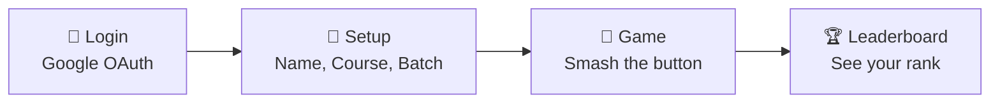

<div align="center">

# 🔴 THE MYSTERY BUTTON

### *One button. Zero chill. Infinite clicks.*

**A real-time clicker game built for a college event, guarded by an 8-layer anti-cheat system that never tells cheaters they got caught.** 😈

[](https://mystery-button-five.vercel.app)


<!-- 📸 REPLACE with a hero screenshot or GIF of the game -->


</div>

---

## 📖 Table of Contents

- [What Is This?](#-what-is-this)
- [Why Does This Exist?](#-why-does-this-exist)
- [Who Is It For?](#-who-is-it-for)
- [Features](#-features)
- [Screenshots](#-screenshots)
- [Tech Stack](#-tech-stack)
- [How It Works](#-how-it-works)
- [The Anti-Cheat Protocol](#-the-anti-cheat-protocol-the-star-of-the-show)
- [Cheater Stories](#-cheater-stories)
- [Database Schema](#-database-schema)
- [API Reference](#-api-reference)
- [Project Structure](#-project-structure)
- [Run It Locally](#-run-it-locally)
- [Deployment](#-deployment)
- [FAQ](#-faq-for-vivas-interviews-and-curious-cats)
- [Docs and References](#-docs-and-references)
- [Credits](#-credits)

---

## 🎯 What Is This?

**In one line:** The Mystery Button is a competitive clicker game where students sign in with Google, smash a big red button as fast as humanly possible, and fight for the top of a live leaderboard, while a hidden anti-cheat system quietly sends cheaters to a fake universe.

The **top 3 real clickers** at the cutoff (**Aug 14, 2026, 4:00 PM IST**) win **Mystery Prizes** 🎁.

> *What's the prize? It's a mystery. That's why it's called the Mystery Button.* 🕵️

---

## 💡 Why Does This Exist?

Because a college event needed something that was:

- **Simple to understand:** press the button, number go up.
- **Competitive:** a live leaderboard means friendships end in seconds.
- **Fair:** the hard part. A clicker game is a cheater's dream, since anyone can write a script that sends a million clicks.

So the real project isn't the button. **The real project is making sure nobody cheats the button.**

---

## 👥 Who Is It For?

| Audience | What they get |
|---|---|
| 🎓 **Students** (24 courses, 3 batches) | A fun way to compete with friends and classmates |
| 🧑‍💼 **Organizers** | A winner list they can actually trust |
| 🧑‍💻 **Developers / learners** | A real-world example of serverless, auth, and anti-cheat design |

---

## ✨ Features

| Feature | What it does |
|---|---|
| 🔴 **Big Red Button** | A satisfying animated button with `+1` particles and selectable sound effects |
| 🏆 **Live Leaderboard** | Filter by course and batch, auto-refreshes, medals for the top 3 |
| 🔔 **Rank Toasts** | Pop-up notifications when you break into the top 50, 25, and 10 |
| 🎁 **Milestone Popups** | Reward images at 1K, 2.5K, 5K, and 10K clicks, with Kerala-flavored captions |
| ⏰ **Event Countdown** | Synced to a hardcoded UTC cutoff, so the game locks for everyone at once |
| ☕ **Bribe the Dev** | A joke popup with a video that leads to a "buy us chaya" QR code |
| 🧩 **Gamified CAPTCHA** | A shape-tapping mini-game that randomly appears to catch bots |
| 👻 **Shadowban System** | Cheaters get their own fake leaderboard. Evil. Beautiful. |

---

## 📸 Screenshots

> 💡 **Add your own screenshots** to `docs/screenshots/` and these will light up.

| 🔐 Login | 📝 Setup | 🔴 Game |
|:---:|:---:|:---:|
|  |  |  |
| *"JOIN THE BATTLE"* | *Name, course, batch* | *Smash it* |

| 🏆 Leaderboard | 🧩 CAPTCHA | 🎁 Milestone |
|:---:|:---:|:---:|
|  |  |  |
| *Medals and filters* | *Tap the star!* | *Reward unlocked* |

---

## 🧰 Tech Stack

### Frontend
| Tool | Role |
|---|---|
| **React 19** | Component-based UI (single-page app) |
| **Vite 6** | Lightning-fast dev server and build tool |
| **React Router 7** | Moves between Login → Setup → Game → Leaderboard |
| **Clerk React SDK** | Google sign-in modal |
| **Vanilla CSS** | Retro / neo-brutalist styling with the *Bangers* font |

### Backend (one codebase, two modes)
| Mode | Tech | Purpose |
|---|---|---|
| 🚀 **Production** | Vercel Serverless Functions (`api/*.js`) | Each route is its own tiny function |
| 🛠️ **Development** | Express.js (`server/index.js`) | A normal local server with hot reload |

Both modes share the same modules, so the logic is written once:
`api/_anticheat.js` (all anti-cheat logic) · `api/_auth.js` (Clerk JWT verification) · `api/_db.js` (Neon connection)

### Data and Services
| Tool | Role |
|---|---|
| **Neon** (Serverless PostgreSQL) | Stores players, scores, and cheat-tracking data |
| **Clerk Backend SDK** | Verifies login tokens on the server |
| **Vercel** | Hosts both frontend and backend |

---

## 🔄 How It Works

### The Player Journey



1. **Login:** click "JOIN THE BATTLE" and sign in with Google.
2. **Setup:** first-timers enter name, course, and batch.
3. **Game:** mash the button. The score updates instantly on your screen.
4. **Sync:** every **3 seconds**, your clicks are sent to the server as one batch (not one request per click).
5. **Leaderboard:** check rankings, filter by course or batch. No login needed to view.

### Frontend Tricks

- **Client-side throttle** at about 15 clicks per second (67ms minimum gap).
- **Batched sync** every 3 seconds, so the server isn't hit on every click.
- **`keepalive: true` on `beforeunload`** flushes unsent clicks when you close the tab.
- **Rank polling** every 10 seconds.
- **Per-click `Date.now()` timestamps** are sent to the server for the bot-detection math.

---

## 🛡️ The Anti-Cheat Protocol (The Star of the Show)

> ### 🏆 The Golden Rule: *A cheater should never know they got caught.*

### The Big Idea: Shadowbanning

When we catch a cheater, we **don't** kick them out, show an error, or freeze their screen. Instead:

- Their clicks silently go to a fake `shadow_score` instead of the real `score`.
- Their screen still shows the score going up. They feel like a winner.
- The leaderboard **hides them** from legitimate players.
- But **they still see themselves** on the board with their fake score.

It's like playing a game where the scoreboard everyone else sees doesn't include you, but you can't tell.

| Viewer | What they see |
|---|---|
| ✅ Legit player | Only real, non-banned players ranked by `score` |
| 👻 Shadowbanned player | Everyone ranked by `score + shadow_score`, including themselves with the inflated number |

### The Request Pipeline

```
Request
  → ① Event Cutoff
  → ② Auth (Clerk JWT)
  → ③ Batch Cooldown
  → ④ Timing Clamp
  → ⑤ Shadowban Check
  → ⑥ Rolling Rate Cap
  → ⑦ Variance Check
  → ⑧ Random CAPTCHA
  → ✅ Score Updated
```

### The 8 Layers

| # | Layer | What it does | Key rule |
|:-:|---|---|---|
| ① | ⏰ **Event Cutoff** | Rejects everything after the deadline | Hardcoded `2026-08-14T10:30:00.000Z` (4:00 PM IST), checked on the *server clock* |
| ② | 🔒 **Authentication** | Every request needs a valid Clerk JWT | One Google account = one score row |
| ③ | ⏱️ **Batch Cooldown** | Blocks rapid-fire scripts | Under 2 seconds since the last sync returns `429 Too Fast` |
| ④ | 📐 **Timing Clamp** | Caps what the server will accept | `min(reported, elapsed × 15, 45)`, with elapsed capped at 30s |
| ⑤ | 👻 **Shadowban Passthrough** | Banned clicks go to `shadow_score` | The API response looks identical |
| ⑥ | 📊 **Rolling Rate Cap** | Catches sustained fast clicking | Over 1200 clicks per 60s counts as a strike, and 3 consecutive strikes means a ban |
| ⑦ | 🤖 **Variance Analysis** | Detects machine-perfect timing | Ban if stddev of click gaps is under 5ms **and** rate is at least 80% of the cap |
| ⑧ | 🧩 **Gamified CAPTCHA** | Random "tap the right shape" challenge | About 10% chance per sync, 5s timer, 2 failures means a ban |

**Bonus:** 👻 **Leaderboard Ghosting** and ⏰ **Hard Cutoff** complete the picture. The same ghosting logic applies to `/api/rank`, so a banned player's position never looks suspicious.

### Show Me the Code (Simplified)

<details>
<summary><b>🔨 The shadowban itself</b></summary>

```js
if (player.is_shadowbanned) {
  // fake score, player never knows
  await sql`UPDATE players SET shadow_score = shadow_score + ${safeClicks} WHERE clerk_id = ${id}`;
} else {
  await sql`UPDATE players SET score = score + ${safeClicks} WHERE clerk_id = ${id}`;
}

// identical response either way
return res.json({ success: true, accepted: safeClicks });
```
</details>

<details>
<summary><b>📐 Timing clamp</b></summary>

```js
const elapsed = Math.min(secondsSinceLast, 30);   // stops "sleep and claim" attacks
const safeClicks = Math.min(reportedClicks, elapsed * 15, 45);
```

Claim 9999 clicks after 3 seconds? The server accepts **45**. The rest vanish. 🪄
</details>

<details>
<summary><b>🤖 Variance check (the bot detector)</b></summary>

```js
const gaps = [];
for (let i = 1; i < timestamps.length; i++) gaps.push(timestamps[i] - timestamps[i - 1]);

const mean = gaps.reduce((a, b) => a + b, 0) / gaps.length;
const variance = gaps.reduce((a, b) => a + (b - mean) ** 2, 0) / gaps.length;
const stddev = Math.sqrt(variance);

if (stddev < 5 && rollingRate >= 0.8 * RATE_CAP) banPlayer();
```

| Who | Click gaps | Std. deviation | Verdict |
|---|---|---|---|
| 🧑 Human | 80, 120, 95, 110, 70 ms | ~20 ms | ✅ Fine |
| 🤖 Autoclicker | 100, 100, 100, 100 ms | 0 ms | 🚨 Banned |
</details>

<details>
<summary><b>👻 Leaderboard ghosting</b></summary>

```sql
-- normal viewer: hide banned players
SELECT name, score FROM players WHERE is_shadowbanned = FALSE ORDER BY score DESC;

-- banned viewer: show everyone, using the fake total
SELECT name, (score + shadow_score) AS score FROM players ORDER BY score DESC;
```
</details>

---

## 🦹 Cheater Stories

Meet our cheaters and see how each one fails.

| 🦹 The Cheater says... | 🛡️ What actually happens |
|---|---|
| *"I'll open 10 tabs and click in all of them!"* | All 10 tabs share the same Google account and the same database row. **One score.** Tabs don't stack. |
| *"I'll script 1000 requests every 100ms!"* | **429 Too Fast.** Everything under the 2-second gap is thrown away. |
| *"My script sends `{ clicks: 9999 }`!"* | Server accepts **45**. Humanly possible clicks only. |
| *"An autoclicker at exactly 14 CPS. Checkmate!"* | Under the rate cap, yes, but the **variance check** sees 0ms of jitter and shadowbans it. |
| *"My bot sends perfect API requests!"* | A **CAPTCHA** appears. Bots can't see shapes, so two failures means a ban. |
| *"I'll change my laptop clock to keep clicking after 4 PM!"* | The cutoff uses the **server's clock**. Your laptop has no vote. 🗳️ |
| *"Haha, I'm #1 with 50,000 points!"* | On *your* screen, yes. Everyone else can't see you. See you at prize time. 💀 |

### 🎬 The Cheater's Journey

```
Step 1: Cheater opens game        → must sign in with Google
Step 2: Cheater fires autoclicker → clamped, rate-checked, variance-checked
Step 3: 💀 SHADOWBANNED           → but they don't know
Step 4: Cheater keeps playing     → happily watching a fake score go up
Step 5: Event ends at 4:00 PM     → real leaderboard shows real winners
Step 6: Cheater checks results    → 😭
```

> **TL;DR:** We don't block cheaters. We let them play in their own fake universe where everything looks fine. 😈

---

## 🗄️ Database Schema

One table. That's it.

```sql
CREATE TABLE players (
  clerk_id TEXT PRIMARY KEY,
  name TEXT NOT NULL,
  course TEXT NOT NULL,
  batch TEXT NOT NULL,
  score INTEGER DEFAULT 0,
  last_click_sync TIMESTAMPTZ DEFAULT NOW(),
  last_click_count INTEGER DEFAULT 0,

  -- Anti-cheat fields
  is_shadowbanned BOOLEAN DEFAULT FALSE,
  shadow_score INTEGER DEFAULT 0,
  click_windows JSONB DEFAULT '[]',
  rate_violations INTEGER DEFAULT 0,
  pending_captcha_id TEXT DEFAULT NULL,
  pending_captcha_target TEXT DEFAULT NULL,
  captcha_issued_at TIMESTAMPTZ DEFAULT NULL,
  captcha_failures INTEGER DEFAULT 0
);
```

Indexed on `course`, `batch`, and `score DESC`.

> **Why is all the anti-cheat state in the database?** Serverless functions have no shared memory and shut down between requests, so every bit of state lives in the player's row.

---

## 🔌 API Reference

| Method | Endpoint | Auth | What it does |
|---|---|:-:|---|
| `GET` | `/api/player` | ✅ | Fetch your profile and score |
| `POST` | `/api/player` | ✅ | Create or update your player (onboarding) |
| `POST` | `/api/score` | ✅ | Submit a click batch (runs the full anti-cheat pipeline) |
| `POST` | `/api/verify-captcha` | ✅ | Verify your CAPTCHA answer |
| `GET` | `/api/leaderboard` | Optional | Ranked list with course and batch filters |
| `GET` | `/api/rank` | ✅ | Your current rank |

### Example: submitting clicks

```http
POST /api/score
Authorization: Bearer <clerk_jwt>
Content-Type: application/json
```

**Normal response** (identical for legit players *and* shadowbanned ones, which is the point):
```json
{ "success": true, "accepted": 42 }
```

**Random CAPTCHA response:**
```json
{
  "success": true,
  "captcha_required": true,
  "captcha": {
    "target_shape": "star",
    "shapes": [
      { "type": "triangle", "x": 15, "y": 30 },
      { "type": "star", "x": 55, "y": 45 },
      { "type": "circle", "x": 35, "y": 60 }
    ],
    "timeout_ms": 5000
  }
}
```

**Too fast:**
```json
{ "error": "Too Fast" }   // HTTP 429
```

**After the event:** every score or player-creation request returns `403`.

---

## 📁 Project Structure

```
mystery-button/
├── api/                        # Vercel serverless functions (production)
│   ├── _anticheat.js           # ← ALL anti-cheat logic lives here
│   ├── _auth.js                # Clerk JWT verification
│   ├── _db.js                  # Neon DB connection
│   ├── score.js                # POST /api/score
│   ├── player.js               # GET/POST /api/player
│   ├── leaderboard.js          # GET /api/leaderboard
│   ├── rank.js                 # GET /api/rank
│   └── verify-captcha.js       # POST /api/verify-captcha
│
├── client/                     # React frontend
│   ├── src/
│   │   ├── pages/              # Login, Setup, Game, Leaderboard
│   │   ├── components/         # BigRedButton, CaptchaChallenge, EventTimer,
│   │   │                       # PlusOneVFX, MuteToggle, RankToast,
│   │   │                       # SearchDropdown, ProtectedRoute
│   │   ├── App.jsx             # React Router config
│   │   ├── main.jsx            # Entry point + ClerkProvider
│   │   └── index.css           # All styles (retro / neo-brutalist)
│   └── vite.config.js
│
├── server/                     # Express dev server (local only)
│   ├── index.js                # All routes (mirrors api/*.js)
│   └── db.js                   # DB connection with dotenv
│
├── init.sql                    # Database schema
├── vercel.json                 # Deployment config
└── package.json                # Monorepo scripts
```

---

## 🚀 Run It Locally

> ⚠️ Double-check the exact script names in `package.json` and the variable names your code reads before sharing. The steps below follow the common setup for this stack.

**1. Clone**
```bash
git clone https://github.com/dhanush-girish/mystery-button.git
cd mystery-button
```

**2. Install dependencies**
```bash
npm install
```

**3. Create accounts (all free tier)**
- 🔐 [Clerk](https://clerk.com): enable Google sign-in and grab your keys.
- 🐘 [Neon](https://neon.tech): create a database and copy the connection string.

**4. Add environment variables**

Create a `.env` file (never commit it!):
```env
# Clerk
VITE_CLERK_PUBLISHABLE_KEY=your_clerk_publishable_key
CLERK_SECRET_KEY=your_clerk_secret_key

# Neon
DATABASE_URL=your_neon_connection_string
```

**5. Create the table**

Run the contents of `init.sql` in your Neon SQL editor.

**6. Start the dev server**
```bash
npm run dev
```

The Vite frontend and the Express dev server run together, with hot reload (`node --watch`) on the backend.

---

## ☁️ Deployment

| Component | Platform |
|---|---|
| Frontend | Vercel (Vite build → static files) |
| Backend | Vercel Serverless Functions (Node.js) |
| Database | Neon (free tier) |
| Auth | Clerk (free tier) |

`vercel.json` routes API requests to the serverless functions and sends everything else to `index.html` for client-side routing.

**Deploy yours:** import the repo into Vercel and add the same environment variables in the project settings.

---

## ❓ FAQ (for vivas, interviews, and curious cats)

<details>
<summary><b>Why send clicks in batches instead of one by one?</b></summary>

One request per click would crush the server and the free database. Batching every 3 seconds is cheaper and faster, and the player still sees instant updates because the score updates locally first.
</details>

<details>
<summary><b>Why shadowban instead of showing an error?</b></summary>

A visible ban teaches the cheater what got detected, so they'd adjust their script and try again. A silent shadowban wastes their time and hides what we catch.
</details>

<details>
<summary><b>Why are the checks on the server and not in the browser?</b></summary>

Anything in the browser can be edited or faked. Only server-side checks can't be tampered with. Even the cutoff uses the server's clock.
</details>

<details>
<summary><b>What if an autoclicker stays under the click limit?</b></summary>

The variance check catches it. A machine clicking every 100ms exactly has about 0ms of jitter, which no human can match.
</details>

<details>
<summary><b>Can a real fast clicker get banned by mistake?</b></summary>

The system tries hard to avoid it: a ban needs **3 consecutive** violations, the variance check needs *both* uniform timing *and* a high rate, and a real player gets a retry on the CAPTCHA.
</details>

<details>
<summary><b>How does serverless "remember" a player's state?</b></summary>

It doesn't. All state (click windows, strikes, CAPTCHA info, ban flag) lives in that player's database row and is read and updated on every request.
</details>

<details>
<summary><b>How does the CAPTCHA stop a bot that sends the right answer?</b></summary>

The server also enforces the 5-second timeout (plus a 2-second network grace) and counts stray clicks on the overlay background as failures. The challenge is random each time.
</details>

<details>
<summary><b>What's the weak spot?</b></summary>

An autoclicker that fakes human-like random jitter could slip past the variance check. That's why there are multiple layers, with rate caps and the CAPTCHA as backups.
</details>

---

## 📚 Docs and References

Everything lives in this repo:

| Document | What's inside |
|---|---|
| 📘 [`Mystery_Button_Event_Summary`](./Mystery_Button_Event_Summary.md) ([PDF](./Mystery_Button_Event_Summary.pdf)) | Project overview, tech stack, endpoints, and the anti-cheat layers |
| 📗 [`Mystery_Button_Project_Documentation`](./Mystery_Button_Project_Documentation.md) ([PDF](./Mystery_Button_Project_Documentation.pdf)) | Detailed project documentation |
| 📙 [`FullStack_Study_Guide`](./FullStack_Study_Guide.md) ([PDF](./FullStack_Study_Guide.pdf)) | Study guide covering the full-stack concepts used here |

### 🔗 Tools used

- [React](https://react.dev) · [Vite](https://vitejs.dev) · [React Router](https://reactrouter.com)
- [Clerk](https://clerk.com/docs) · [Neon](https://neon.tech/docs) · [Vercel Functions](https://vercel.com/docs/functions)
- [Express](https://expressjs.com) · [Bangers font](https://fonts.google.com/specimen/Bangers)

### 🔑 Quick Stats

| Metric | Value |
|---|---|
| Lines of anti-cheat code | ~300 (one file) |
| External dependencies in anti-cheat | **0** (pure JavaScript) |
| API endpoints | 6 |
| Frontend pages | 4 |
| React components | 8 |
| Database tables | 1 |
| Supported courses | 24 |
| Max legit CPS | 15 (client) / 20 (server rolling cap) |
| CAPTCHA timeout | 5 seconds |

---

## 🙌 Credits

Built by [**@dhanush-girish**](https://github.com/dhanush-girish) for a college event.

If you enjoyed this, leave a ⭐ on the repo. It helps more than clicking the red button.

<div align="center">

**Built with ☕ and questionable amounts of clicking.**

*Remember: the button sees everything.* 👁️🔴

</div>
